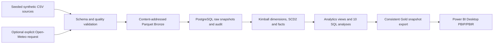
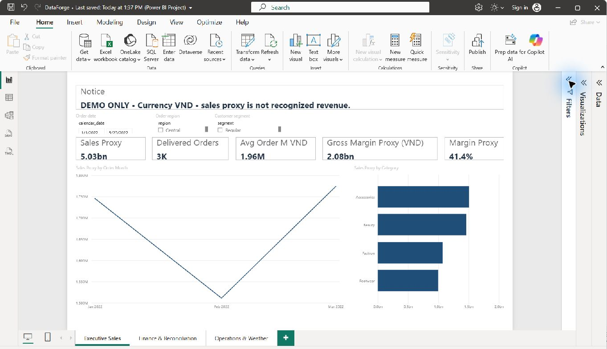
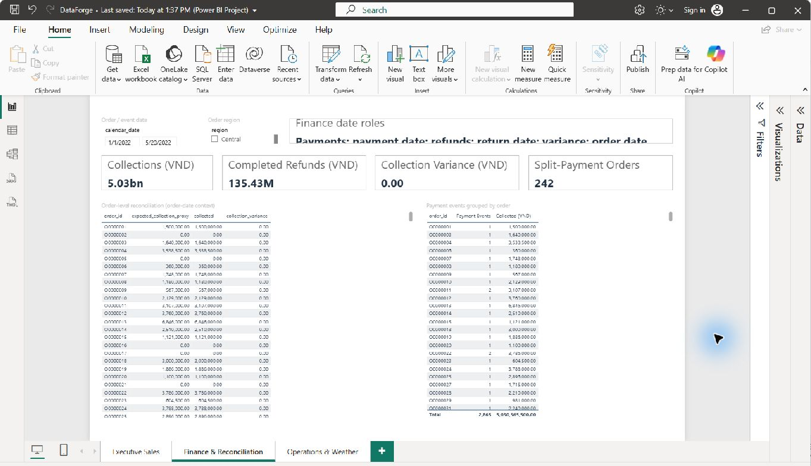
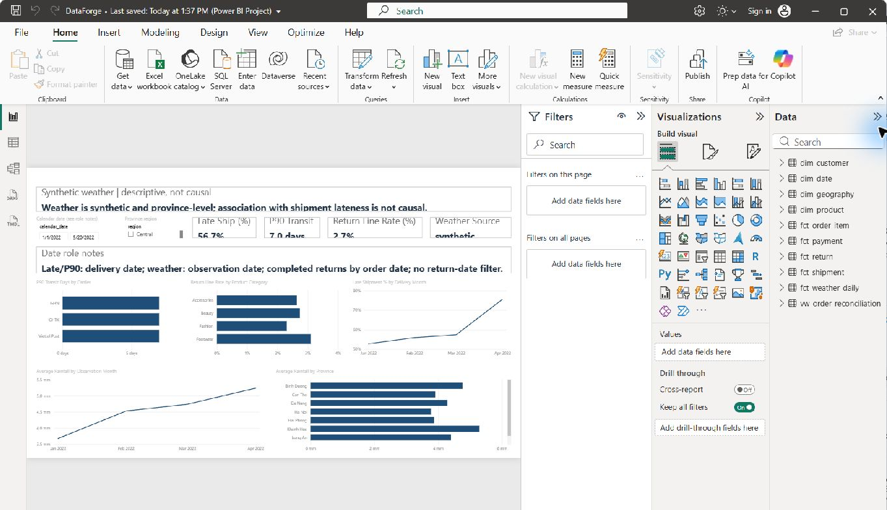

# DataForge — Local Commerce Analytics (v1.0-local)

**Current local acceptance: GO LOCAL (P6.2).** DataForge combines Intern Data Engineer Mini-projects 1 and 2 into a reproducible, synthetic-first Order-to-Cash analytics portfolio.

**CSV → contract validation → content-addressed Parquet → PostgreSQL raw/audit → Kimball dimensions and facts → 10 SQL analyses → Power BI Desktop.** Optional weather retrieval is an explicit API action; the default fixture uses synthetic weather.

The business problem is to reconcile commerce orders, item lines, payment events, returns, shipments and weather without joining unrelated facts at the wrong grain. The project demonstrates data contracts, reproducible local ingestion, dimensional modeling, event-date semantics and report-level validation. It is an educational reference, not a production service or accounting system.

## Architecture



The fuller architecture and grain register are in [`docs/architecture.md`](docs/architecture.md); the relationship diagram is [`docs/diagrams/star_schema.mmd`](docs/diagrams/star_schema.mmd).

## Tech stack

- Python 3.11, pandas, PyArrow and psycopg
- Parquet snapshots with SHA-256 integrity and source manifests
- PostgreSQL 16, SQL, Kimball dimensions/facts and SCD2 customer history
- Docker Compose for local PostgreSQL
- Power BI Desktop Import model with PBIP/PBIR/TMDL, DAX and demonstration RLS
- GitHub Actions configuration for Python 3.11/PostgreSQL 16 CI

`v1.0-local` is the repository portfolio release label; the Python package is not published to PyPI.

## Mini-project 1 — Ingestion and Parquet

The deterministic generator creates 11 fictional commerce source tables (3,000 orders by default). CSV contracts validate columns, types, keys and business ranges. Ingestion records source and Parquet hashes, writes content-addressed Bronze files and atomically promotes a complete active manifest. Changed sources load into PostgreSQL as complete snapshots with audit deltas; invalid or corrupted inputs fail closed. Optional Open-Meteo retrieval is explicit and separately provenance-checked.

## Mini-project 2 — Kimball warehouse, SQL and Power BI

The PostgreSQL warehouse preserves distinct fact grains for order items, payments, returns, shipments, inventory snapshots and weather. Dimensions include date, geography, product and customer SCD2. Ten analysis queries cover monthly sales, cohorts, deliveries, returns, inventory risk and order-level payment reconciliation. The Power BI model contains 10 synthetic Gold tables, 15 single-direction relationships, delivery-date measures and the `South_Region_Viewer` demo role. Inventory is excluded from regional RLS because the source fact has no geography key.

## Setup

Requirements: Git, Python 3.11, Docker Desktop and Power BI Desktop. Clone the public repository, then run these commands from PowerShell:

```powershell
git clone https://github.com/Dat071104/dataforge-commerce-platform.git
Set-Location .\dataforge-commerce-platform
if (-not (Test-Path .env)) { Copy-Item .env.example .env }
# Set a unique local-only password in .env. Keep it private.
.\scripts\bootstrap_windows.ps1
# Bootstrap installs the dev and Power BI export extras under the Python 3.11 lock.
docker compose up -d --wait
```

Compose binds PostgreSQL to `127.0.0.1:5433` only. The `.env` file is ignored by Git.

## End-to-end demo

```powershell
.\scripts\demo_windows.ps1
.\.venv\Scripts\dataforge.exe reference-metrics
```

The script generates 3,000 orders with seed 42, validates 11 CSV sources, writes content-addressed Parquet snapshots, loads PostgreSQL, builds Gold marts, verifies synthetic checks and five financial controls, runs all ten SQL analyses, then repeats ingest/load/build to check safe reruns. `generate` refuses to overwrite a non-synthetic, externally sourced, or hash-mismatched source folder. To run a single analysis:

```powershell
Get-ChildItem .\sql\analysis\q*.sql | Sort-Object Name | ForEach-Object {
  .\.venv\Scripts\dataforge.exe query $_.BaseName
}
```

The independent CSV `Decimal` oracle exactly matched PostgreSQL for fulfilled-sales proxy, fulfilled COGS proxy, successful collections, completed refunds and collection variance. These are synthetic analytics metrics; fulfilled sales proxy is not accounting-recognized revenue.

## Power BI Desktop report

The editable project is [`dashboards/P5/DataForge/DataForge.pbip`](dashboards/P5/DataForge/DataForge.pbip). It has three pages: Executive Sales, Finance & Reconciliation, and Operations & Weather. The semantic model has 10 synthetic Gold tables, 15 one-way relationships, an inactive delivery-date role, explicit measures and the `South_Region_Viewer` demo role. Inventory is excluded because the source fact has no geography key. The PBIP ships with an unconfigured `GoldWorkbookPath` sentinel; configure it to the regenerated local Gold workbook before opening or refreshing.

### Verified dashboard screenshots

These are the three current-source P6.2 Desktop captures; they show synthetic demonstration data.

| Executive Sales | Finance & Reconciliation | Operations & Weather |
|---|---|---|
|  |  |  |

Before refreshing the report, regenerate the local Gold workbook snapshot and configure the explicit local path:

```powershell
.\.venv\Scripts\python.exe .\scripts\export_powerbi_gold.py --excel
.\.venv\Scripts\python.exe .\dashboards\P5\configure_workbook_path.py `
  --project .\dashboards\P5\DataForge\DataForge.pbip `
  --workbook .\data\powerbi_gold_export\DataForgeGold.xlsx `
  --dry-run
.\.venv\Scripts\python.exe .\dashboards\P5\configure_workbook_path.py `
  --project .\dashboards\P5\DataForge\DataForge.pbip `
  --workbook .\data\powerbi_gold_export\DataForgeGold.xlsx `
  --backup-dir .\.local\path_backups
.\.venv\Scripts\python.exe .\dashboards\P5\validate_source_pack.py `
  --project .\dashboards\P5\DataForge\DataForge.pbip `
  --workbook .\data\powerbi_gold_export\DataForgeGold.xlsx
```

The helper checks the synthetic classification, workbook SHA-256, sheet names and row counts before making a backup and updating the TMDL path. The PBIP source ships with an unconfigured sentinel, not a personal absolute path. After the preflight and validator pass, open the PBIP in Desktop and choose **Refresh**. If the workspace moves, rerun the helper with the moved PBIP and workbook paths. See [`dashboards/POWER_BI_GUIDE.md`](dashboards/POWER_BI_GUIDE.md). The linked `docs/screenshots/v1.0-local/` images are the current P6.2 acceptance captures.

## Validation

```powershell
$env:RUN_POSTGRES_TESTS = "0"
.\.venv\Scripts\python.exe -m pytest -q tests dashboards/P5/tests
$env:RUN_POSTGRES_TESTS = "1"
.\.venv\Scripts\python.exe -m pytest -q -o faulthandler_timeout=60 tests dashboards/P5/tests
Remove-Item Env:RUN_POSTGRES_TESTS
.\.venv\Scripts\ruff.exe check src tests scripts dashboards/P5
.\.venv\Scripts\python.exe -m compileall -q src tests scripts dashboards/P5
.\.venv\Scripts\python.exe -m pip check
```

The PostgreSQL integration suite uses isolated uniquely named temporary databases. Current local verification and the P6.2 GO LOCAL decision are summarized in [`docs/releases/v1.0-local.md`](docs/releases/v1.0-local.md). Full internal phase logs are retained locally and excluded from the portfolio bundle. GitHub Actions runs these gates on push and pull request; check the Actions tab for actual remote status.

## Data and metric boundaries

- Commerce fixtures are fictional and deterministic, not actual retailer transactions.
- The optional Open-Meteo Historical API call is explicitly requested; the free API is for non-commercial use and requires CC BY 4.0 attribution. Review current [terms](https://open-meteo.com/en/terms) and [licence conditions](https://open-meteo.com/en/licence) before reuse or distribution.
- The [IVin Datathon repository](https://github.com/vin-datathon-2026/round1) had no visible license or reuse terms in its reviewed root/README; its CSVs were not downloaded or integrated.
- Facts retain separate grains. Payments, returns, shipments and item lines must be aggregated independently before reconciliation. Weather/shipment association is descriptive, not causal.
- Raw loading is changed-hash complete-snapshot merge; facts are rebuilt on each `db-build`. This is not CDC or a production service-level guarantee.
- Legacy manifests without a Parquet-byte digest fail closed. Run full `dataforge ingest` to validate the CSV and safely migrate only matching legacy Parquet artifacts before `db-load`.
- Open-Meteo source files must agree with the marker and complete provenance sidecar. Failed date coverage or stale provenance is rejected before a new active ingest run is promoted.

### KPI definitions

| KPI | Definition and reporting caveat | Unit |
|---|---|---|
| Fulfilled Sales Proxy | Net value of delivered order lines; **not** recognized revenue. | VND |
| Fulfilled COGS Proxy | Quantity × product unit cost on delivered lines. | VND |
| Gross Margin Proxy | Fulfilled sales proxy − fulfilled COGS proxy; excludes shipping, tax and overhead. | VND |
| Average Order Value | Fulfilled sales proxy ÷ distinct delivered orders in the current item-fact filter context. | VND |
| Collections / Completed Refunds | Successful payment events by payment date / completed return refunds by return date; keep event dates separate. | VND |
| Collection Variance | Successful collections less fulfilled-sales proxy, summed at one row per order under order-date context. | VND |
| Return Line Rate | Delivered item lines with at least one completed return ÷ delivered item lines; an order-date cohort rate, not a unit-return rate. | % |
| Late Shipment Rate / P90 Transit | Delivered shipments over the hypothetical 3-day threshold / inclusive 90th percentile of delivered non-null transit days, using delivery-date context. | % / days |

See [`docs/metric_contract.md`](docs/metric_contract.md) for full definitions and exclusions. These synthetic-demo metrics are not accountant-approved.

## Repository structure

```text
src/dataforge/                 ingestion, validation, warehouse and CLI modules
configs/                        source contracts
sql/schema, sql/build, sql/analysis, sql/checks
scripts/                        Windows workflow, export, controls and benchmark
tests/                          unit and isolated PostgreSQL integration tests
dashboards/P5/                  PBIP/PBIR/TMDL, path configurator and validator
.agents/skills/dataforge-*      focused reusable project workflows
.github/workflows/ci.yml        GitHub Actions CI configuration
docs/                           architecture, contracts, operations and release evidence
```

Generated source CSVs, Parquet snapshots, manifests, Gold workbook exports, Power BI caches, local credentials and Codex run history are intentionally excluded.

## Documentation

- [Architecture and grain register](docs/architecture.md) and [Mermaid diagrams](docs/diagrams/)
- [Data dictionary](docs/data_dictionary.md), [business requirements](docs/business_requirements.md), and [metric contract](docs/metric_contract.md)
- [Data quality and reconciliation](docs/data_quality_and_reconciliation.md), [SQL catalog](docs/query_catalog.md), and [performance benchmark](docs/performance_benchmark.md)
- [Windows runbook and recovery](docs/operations_runbook.md), [source provenance](docs/source_provenance.md), and [syllabus coverage](docs/SYLLABUS_COVERAGE.md)
- [v1.0-local release evidence](docs/releases/v1.0-local.md)

## Status boundaries and roadmap

### IMPLEMENTED AND VERIFIED LOCALLY

- Python ingestion and contracts, Parquet Bronze, PostgreSQL raw/Gold, 10 SQL analyses, financial controls and reproducible synthetic fixtures.
- Power BI PBIP/PBIR/TMDL source, three rendered report pages, DAX/SQL controls, demonstration South RLS and local workbook relocation checks.
- Docker Compose and GitHub Actions CI configuration are included. CI is not a deployment pipeline; see Actions for the actual remote run result.

### PLANNED FOR GCP — not deployed or tested

| Future/analogous platform concept | Possible GCP direction |
|---|---|
| Azure Data Lake Storage | Google Cloud Storage |
| Fabric Warehouse | BigQuery |
| Batch execution | Cloud Run Jobs |
| Scheduling | Cloud Scheduler / Workflows when needed |
| dbt | dbt-bigquery |
| Azure Key Vault | Secret Manager |
| Azure RBAC / Entra authorization | Google Cloud IAM |
| Infrastructure as Code | Terraform |

The current implementation remains local Python, Parquet and PostgreSQL. These are functional mappings, not exact product equivalents. No Cloud Run, BigQuery, GCS, dbt-bigquery, Terraform or other GCP resources have been deployed or tested. No paid cloud resource or Power BI Service report is part of this release.

### UNVERIFIED / FUTURE WORK

- Production security/authorization, service-level objectives, CDC, incremental fact builds and real retailer/accounting semantics.
- Official Microsoft PBIR schema validation and a Desktop UI reopen from the relocated PBIP were not performed.
- Real external commerce data remains blocked until its license, schema and provenance are independently verified. Synthetic metrics must not be presented as observed sales or recognized revenue.

## License and development note

Original DataForge source and documentation are licensed under the [MIT License](LICENSE). Third-party dependencies retain their own licenses; no third-party dataset or live Open-Meteo response is included. Parts of the implementation and documentation were developed with AI assistance; the maintainer reviewed and verified the local results and is responsible for the published content. The Python package is not published to PyPI.
