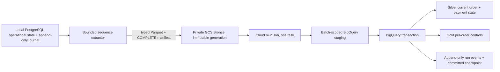

# P7.2 Week 5 — Architecture and ADR

**Status:** P7.2.0 design baseline recorded on 2026-11-10. The bounded Week-5 implementation and INC-01–INC-10 live evidence are now recorded under `docs/cloud/week5/`; the final independent controller verdict is pending.

## Decision

Add a separate operational reference source and an append-only change journal. Keep the accepted `data/source/`, `src/dataforge/database.py`, snapshot cloud adapter, P6.2 local marts, and P7.1 Week-4 data unchanged. The local source is PostgreSQL; deterministic extraction emits typed Parquet and a COMPLETE manifest; a private GCS object generation is consumed by a finite Cloud Run Job; BigQuery staging, Silver state, the Week-5 Gold projection, run ledger, and checkpoint are updated through a bounded BigQuery workflow.

The cloud consumer receives an explicit manifest URI and generation. It never reads the laptop, local PostgreSQL, a mutable `latest` object, or developer-only files. The local source-to-GCS bridge is manual and bounded; when the laptop is offline, the cloud has no new source changes to discover.

## Source identity, ordering, and watermarks

- Source identity is `dataforge-operational-v1`; event schema version is `1`.
- `change_seq` is the authoritative ordering and checkpoint key. One global journal sequence covers `orders` and `payment_events`.
- The PostgreSQL simulator serializes writers with a transaction-scoped advisory lock. Operational state mutation and journal append occur in the same database transaction. This avoids assuming that `BIGSERIAL` allocation order is commit order under concurrent transactions.
- `change_id` is stable and unique. Reusing an ID with the same canonical event digest is an exact retry; reusing it with different content fails closed.
- `source_updated_at` is a UTC source timestamp. `business_event_at` is the business timestamp/date represented by the event. A later journal event may legitimately carry an older source timestamp or business date.
- A composite `(source_updated_at, change_seq)` cursor is demonstrated as a compatibility example. It is not the recovery authority: an event delivered later with a timestamp older than the last cursor can be missed unless an overlap or explicit backfill is used. Sequence capture handles retroactive timestamps without reordering source truth.
- Normal extraction begins at `committed_checkpoint + 1`, captures an upper sequence within one consistent database snapshot, and obeys `--max-events`. Explicit `--from-seq/--to-seq` backfill is bounded and never silently rewinds the BigQuery checkpoint.

## Keys, grains, payloads, and deletes

| Stream | One current row per | Natural key | Monetary value |
|---|---|---|---|
| `orders` | order | `order_id` | `order_net_amount NUMERIC(18,2)` |
| `payment_events` | payment event | `payment_id` | `amount NUMERIC(18,2)` |

Insert and update events carry a complete post-image for their business row. Delete events carry the business key and are explicit tombstones; row absence from a delta batch never means delete. Silver retains tombstones with `is_deleted=true`, last valid attributes, `effective_seq`, `change_id`, and payload provenance.

An order tombstone does not cascade into payment events. Gold marks the order deleted, gives its delivered-sales proxy a value of zero and marks its variance not comparable, while preserving and exposing successful payment collections against that order. A payment tombstone excludes that event from current successful collections but keeps its key/version for audit. An orphan payment referencing no Silver order fails the publish check; a payment attached to a tombstoned order remains visible.

## Metrics and reconciliation

The Week-5 Gold table is exactly one row per order. The synthetic delivered-sales proxy is the order amount when an order is active and `status='delivered'`, otherwise zero. Collections are the `NUMERIC` sum of active payment events with `status='success'`, aggregated by order before reconciliation. For a non-deleted order, `collection_variance = collected - delivered_sales_proxy`. A deleted order has a null variance because its order financial state is no longer comparable, but its independent payment events remain present. Payment, order, and item grains are never joined before aggregation. These values are educational synthetic controls, not accounting-recognized revenue.

`order_date` is retained in the order-level Gold record. A correction that moves an order to an earlier business date updates only its affected order row. `gold.week5_monthly_controls` is a logical view over those current rows; it recomputes the period totals when queried, and keeps collections for tombstoned orders visible in a separate control. This reference does not claim that the existing local P6.2 marts are incrementally maintained.

## Batch identity, immutability, and staging

- A batch ID is derived from source identity, lower/upper journal bounds, and the canonical event-row digest. `run_id` identifies an execution attempt and does not define batch identity.
- Parquet uses an explicit Arrow schema: sequence `INT64`; UTC timestamps; strings for identifiers, operation, wire `schema_version` value `"1"`, canonical JSON payload, and SHA-256 values. VND values stay decimal strings in JSON payloads and become BigQuery `NUMERIC`; no binary floats are used.
- The Parquet object path is content-addressed by its SHA-256. A retry reuses an existing object only if bytes, generation, size, and metadata match. The COMPLETE manifest has a deterministic source-run identity derived from the batch, and includes its immutable generation, SHA-256, size, row-value digest, key uniqueness controls, source identity, inclusive bounds, schema, counts, and timestamp ranges.
- Cloud Run fetches both manifest and data by requested generation with generation-match preconditions, verifies all checksums and metadata, validates schema and unique event keys, then loads the verified local bytes into a batch-scoped BigQuery staging table. It does not ask BigQuery to resolve a mutable GCS URI after validation.
- A staging table is disposable and expires after seven days. A previously published batch is recognized from durable `ops` state and returned as an observable no-op even if its staging table has expired.

## BigQuery publication boundary and concurrency

The durable state machine is `DISCOVERED -> VALIDATED -> STAGED -> MERGED -> CHECKED -> PUBLISHED`, with `FAILED` or `QUARANTINED` recorded for errors. Each transition is a deterministic event in `ops.week5_run_events` with run ID, batch/source-run IDs, sequence bounds, manifest/object hashes and generation, attempt, staging and publish BigQuery job IDs, checkpoint values, timestamps, controls, and a sanitized error code. `MERGED`, `CHECKED`, `PUBLISHED`, and checkpoint events commit together; if the transaction rolls back, those status rows roll back too. The runtime records early validation/staging failures after the error and avoids duplicating a `FAILED` row already written by the transaction handler.

One BigQuery multi-statement transaction performs these operations as a unit:

1. Acquire the transaction-level writer lock and validate checkpoint/backfill semantics.
2. Deduplicate and validate the staged event rows by `change_seq` and `change_id`; conflicting duplicate identities or versions fail closed.
3. MERGE the latest valid event per business key into order and payment Silver state, guarded by `effective_seq` so old replays cannot revert current rows.
4. Recompute Gold only for order IDs affected by the batch, using current Silver payments pre-aggregated by order.
5. Assert no duplicate current keys, no orphan payments, and source/target control parity.
6. Append the `PUBLISHED` run event and advance the committed checkpoint (normal mode only) in the same transaction.

If any statement fails after Silver MERGE but before commit, BigQuery rolls the entire transaction back; the previously committed Gold and checkpoint stay visible. The job records `FAILED` after rollback. A retry validates and reuses the immutable batch, then converges deterministically. Published-batch replay is a read-only no-op. BigQuery cannot atomically commit the GCS upload with warehouse mutations, so a complete but unpublished object can remain orphaned after a failed load; it never advances the checkpoint.

Concurrency is explicitly single-writer. The Cloud Run job has `taskCount=1` and `parallelism=1`; the transaction mutates a shared lock table first so concurrent transaction attempts fail rather than race publication. Job retry is bounded. Concurrent source writers are also serialized at the PostgreSQL journal boundary.

Ordinary BigQuery lookup, event, and staging-verification jobs are capped at 256 MiB billed. The multi-statement publication transaction uses a separate 1 GiB per-job ceiling because the first six-event run reached the smaller cap across child ASSERT statements; every script parent and child job is retained in `bq_job_ids.json`. Actual Week-5 publish jobs remained below the 1 GiB ceiling.

## IAM and locations

Only project `dataforge-p7-lab-d0f725`, region `us-central1`, bucket `dataforge-p7-lab-d0f725-bronze`, and existing `staging`/`silver`/`gold` datasets are in scope. Create a narrow `ops` dataset for checkpoint and run-history durability. The keyless runtime account receives bucket object-viewer access, BigQuery job execution, and dataset-scoped editor roles only for `staging`, `silver`, `gold`, and `ops`. No Owner/Editor role, key JSON, public bucket, HTTP service, scheduler, or unrelated project is in scope.

The Cloud Run and Artifact Registry APIs were enabled using additive Terraform resources after a reviewed zero-destroy plan; the private repository and finite Cloud Run Job were then created in the approved project. The refreshed post-run plan reports no drift. The Billing API remains disabled. No Cloud SQL, VM, GKE, Composer, Pub/Sub/Kafka, Workflows, Scheduler, managed Spark, or billing-plan upgrade was created or enabled in Week 5.

## Cost and rollback

The operational project target remains USD 10; Week-5 incremental usage is capped by the task at USD 5. The Week-4 usage estimate was below USD 0.02. The current-month billing report did not show a settled DataForge row, and a hard budget cap is not configured; exact settled spend is therefore unknown. Enforce bounded batch sizes, one Cloud Run task, one retry, a short timeout, explicit query byte caps, sequential execution, and stop on unexpected resource/usage or cost forecast above either limit. The active-trial credit indication is not a spending cap.

The rollback boundary is the BigQuery transaction: failed quality, injected failure, or concurrency conflict cannot publish partial Silver/Gold/checkpoint changes. Preserve all Week-4 objects and datasets. Delete only temporary resources created by this phase after identifying them in a fresh Terraform plan and test receipt; keep the Week-5 Gold, ledger, checkpoint, and job for the next phase.

## Watermark comparison

| Cursor | Strength | Failure boundary | Use |
|---|---|---|---|
| `change_seq` | Captures committed journal order, including retroactively timestamped events; replay and checkpoint are precise | Requires a trustworthy serialized journal writer and explicit bounded backfill for old ranges | Authoritative cursor and checkpoint |
| `(source_updated_at, change_seq)` | Deterministic ordering among equal timestamps and useful for timestamp-based systems | Does not catch an event that arrives later with a timestamp earlier than the saved timestamp unless overlap/backfill is explicit | Demonstration only; never the sole recovery cursor |
