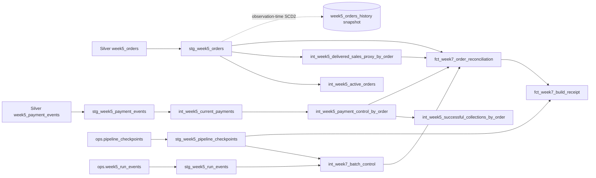

# Week 7 dbt lineage

Generated from [`artifacts/manifest.json`](artifacts/manifest.json) after the seq-30 full pipeline. The graph contains only the deterministic Week 5 operational simulator's two source grains plus its control metadata.

The `int_week5_successful_collections_by_order` model is an independently aggregated control path. The reconciliation fact also uses `int_week5_payment_control_by_order`, which aggregates the payment grain before joining to order grain. This prevents multiple payment events from multiplying delivered sales.

Publication is a separate step after the dbt graph: a successful candidate/test run is copied into an immutable `gold_week7` version, then the compare-and-set pointer is switched. The public view filters on the pointer's `publication_is_current` flag and exposes no rows while the flag is false.
