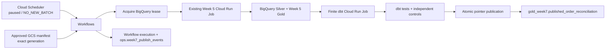

# Week 7 orchestration runbook

## Production boundary

Cloud Scheduler does not connect to a developer laptop or read the local PostgreSQL source. Its fixed payload is `NO_NEW_BATCH`; the schedule is paused by default and is removed after the bounded verification run. New source data enters through the existing Week 5 exporter, which uploads a complete immutable manifest and its Parquet object to the approved Bronze prefix.



The `gold_week7.week7_publication_pointer` is the only public current-version marker. Lease acquisition clears `publication_is_current`; the stable `published_order_reconciliation` view filters to true and returns no rows while Silver is ahead or validation is incomplete. After dbt tests and reconciliation pass, publication appends an immutable version, advances the pointer, and restores the flag to true atomically. Candidate tables may be repaired or rebuilt without changing the published view.

## Manual source and execution

Use the existing isolated operational simulator only for approved synthetic tests. The Week 4 snapshot database and accepted Week 5 checkpoints are outside this flow.

```powershell
. D:\DATA_ENGINEER\DataForge\scripts\enter_dataforge_cloud.ps1
& D:\DATA_ENGINEER\DataForge\.venv\Scripts\python.exe `
  D:\DATA_ENGINEER\DataForge\scripts\week5_incremental.py batch --max-events 1000 --execute
```

Copy the resulting `manifest_uri`, `manifest_generation`, and `batch_id` into one bounded Workflow invocation:

```powershell
& D:\DATA_ENGINEER\DataForge\.venv\Scripts\python.exe `
  D:\DATA_ENGINEER\DataForge\scripts\week7_run_workflow.py `
  --manifest-uri '<approved-gs-uri>' `
  --manifest-generation <exact-generation> `
  --batch-id <manifest-sha256> `
  --run-mode normal `
  --output docs/cloud/week7/workflow_receipt.json
```

For a controlled backfill, export an explicit bounded sequence range with `week5_incremental.py batch --from-seq N --to-seq M --execute`, then pass `--run-mode backfill`. A backfill updates current Silver/Gold state but does not move the normal committed checkpoint. Do not use a later backfill object to bypass the source journal's normal checkpoint.

The Workflow validates the target bucket, object path, immutable generation, manifest status/schema, source identity, sequence range, batch digest, Parquet object generation/digest, and approved run mode before it invokes either Cloud Run Job. `NO_NEW_BATCH` requires no manifest fields and never invokes Cloud Run.

## Expected outcomes

| Status | Meaning | Operator action |
|---|---|---|
| `NO_NEW_BATCH` | No complete immutable manifest was supplied. | No action; source remains untouched. |
| `PUBLISHED` | Silver, dbt build/tests, independent control checks, and pointer commit succeeded. | Save the execution receipt and validate the current pointer. |
| `NO_OP` | The batch is already committed and its candidate checksum matches the current published version. | Treat as idempotent replay; verify checkpoint and pointer did not change. |
| `OVERLAP_SKIPPED` | Another workflow owns the lease. | Do not start a second direct job; inspect the owner execution and retry only after it is terminal. |
| Failed execution | An input, IAM, Cloud Run, dbt, test, reconciliation, or publication step failed. | Preserve the manifest and execution ID; follow the recovery table below. |

The Workflows identity acquires the singleton BigQuery lease before Week 5. It holds the lease through candidate validation and pointer publication, then releases it. Cloud Run operation polling uses a custom project role containing only `run.operations.get`; job invocation uses a custom role with `run.jobs.run` and `run.jobs.runWithOverrides` bound separately to the two approved jobs. The lease lasts 2,400 seconds and publication renews it inside the commit transaction. A failed release leaves a time-bounded lease, which the next owner may take after expiration.

## Recovery

| Failure point | Expected state | Recovery |
|---|---|---|
| Before manifest validation | No lock, Cloud Run job, checkpoint, or pointer change. | Correct the object/input; submit the exact verified generation. |
| Week 5 task failure before commit | Week 5 transaction rolls back; normal checkpoint and Silver/Gold do not advance. | The existing Week 5 job performs its configured bounded retry once. If exhausted, inspect its failure ledger and rerun the same manifest after terminal completion. |
| Silver/Week 5 Gold committed, dbt build or test failed | Week 5 checkpoint stays committed; the current Week 7 pointer and immutable published version remain unchanged. | Fix the model or data issue, then replay the exact manifest. Week 5 returns `NO_OP`; dbt rebuilds from the committed Silver state. |
| Pointer transaction fails | Candidate may exist, but no immutable version or pointer advancement is committed. | Replay the exact manifest after the error is resolved; publication is fenced by the same checksum and pointer version. |
| Candidate corruption | Lease acquisition clears the currentness flag; the public view returns no stale rows. | Run `scripts/week7_run_candidate_full_refresh.py --target-dataset dev --batch-id <batch> --manifest-generation <generation> --upper-seq <sequence> --run-mode <normal|backfill> --execute`, rerun validation, then replay the exact manifest. The helper only starts the bounded dbt Cloud Run Job; it never calls the publication macro. Never edit the immutable version table or pointer by hand. |
| Concurrent trigger | One lease owner proceeds; other execution returns `OVERLAP_SKIPPED` before Week 5. | Wait for the owner to become terminal; inspect the event ledger before retrying. |

Do not blindly start a replacement Workflow while a Cloud Run operation is still running. A Workflow execution can fail to observe an operation even after its request was accepted; verify the Cloud Run execution and lock owner before recovery. The lease prevents a failed build from being advertised as current, but it does not cancel a started job.

## Airflow reference

`labs/airflow_reference/dags/dataforge_week7_reference.py` models the same logical ordering for syllabus coverage. Run `labs/airflow_reference/ci.ps1` for `no_new_batch`, `local_fixture`, `retry_once`, and `invalid_mode`. Docker uses network mode `none`, a temporary SQLite metadata database, and a read-only mount of only the reference DAG directory. It does not access GCP, execute dbt, publish Gold, or start an Airflow scheduler. It is not a second production scheduler.
