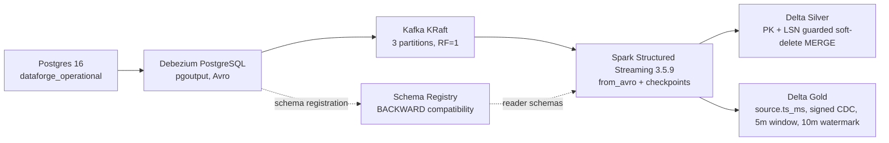

# Week 8 — Streaming CDC

**Scope:** local Docker Compose and GitHub Actions only. This lane is built in `feat/w8-cdc-streaming`; it does not write to GCP or a hosted service.

The operational source in this repository is `dataforge_operational.orders` and `dataforge_operational.payment_events`, with an append-only `dataforge_operational.change_journal`. The source has no `order_items` or `customers` tables, so this lab uses the tables that exist. The stream uses `orders` as the silver CDC target and `orders` changes for the revenue window.

With `topic.prefix=dataforge`, the connector publishes `dataforge.dataforge_operational.orders`, `dataforge.dataforge_operational.payment_events`, and `dataforge.dataforge_operational.change_journal`. Transaction metadata is emitted to `dataforge.transaction`.

## Runtime versions

| Component | Selected version | Notes |
|---|---:|---|
| PostgreSQL | `postgres:16.16-alpine3.23@sha256:c20bbcd4348a9f727d4b9c06e9bf042ca6fa4e90b201edfdfe8daeb200e8ca91` | Same major as the operational source lab; logical WAL enabled. Platform: linux/amd64. |
| Kafka / KRaft | `confluentinc/cp-kafka:7.9.11.amd64@sha256:fc0ba252389cf7509b92b20ba6d0e2cde92408812c98127d30d3a1810ca41a68` | Kafka 3.9; one local broker, three partitions per CDC topic, RF=1. Platform: linux/amd64. |
| Schema Registry | `confluentinc/cp-schema-registry:7.9.11.amd64@sha256:8fa2069cd2a1f22dd32dea021151b90639ed2e2aa8caac63952b094a64374733` | Avro, BACKWARD compatibility. Platform: linux/amd64. |
| Kafka Connect base | `confluentinc/cp-kafka-connect:7.9.11.amd64@sha256:82ef611a6547fd513cb52891326c3d5a8a5e30c8ea511e71f9813c93ad98482f` | Local image adds the Debezium PostgreSQL 3.1.3.Final plugin archive from Maven Central, verified by SHA-256. |
| Spark base | `python:3.11.18-slim-bookworm@sha256:e8c69d86735f6df3efa06b324694fe51f0422785f83a3bd463052636c2421944` | Local image adds Spark 3.5.9, Delta 3.3.3, and Java 17. |
| Spark runtime | 3.5.9 | Reuses the Week 6 Spark baseline. |
| Java | 17 | Shared runtime target for Spark 3.5 and Kafka Connect. |
| Spark Kafka source | `org.apache.spark:spark-sql-kafka-0-10_2.12:3.5.9` | Structured Streaming Kafka source. |
| Delta Lake | `delta-spark==3.3.3` | Reuses the Week 6 Delta baseline; compatible with Spark 3.5.x. |
| Spark Avro | `org.apache.spark:spark-avro_2.12:3.5.9` | Decodes the Confluent Avro payload after its 5-byte wire header is removed. |

**Image pinning:** every published image reference uses a version tag and immutable amd64 digest. Locally built Connect/Spark images use those pinned base images and explicit dependency versions.

## Run locally

From the repository root, start the stack, add a demonstration order, and emit an insert/update/delete burst:

```powershell
python -m labs.streaming_cdc.cli up
python -m labs.streaming_cdc.cli seed
python -m labs.streaming_cdc.cli mutate
```

Stop the stack with `python -m labs.streaming_cdc.cli down`. GNU Make aliases are available with `make -C labs/streaming_cdc w8-up` and `w8-down`.

For a fresh run, `python -m labs.streaming_cdc.cli reset` stops the project, removes its Kafka/Postgres volumes, and clears only the ignored Week 8 checkpoint/state directory.

The Compose project is `dataforge-w8`. Host ports are PostgreSQL `55433`, Kafka `19093`, Schema Registry `18081`, Connect REST `18083`, Spark UI `14040`, and the local Spark status API `17079`. The stack caps container memory at 5,376 MiB and checks for at least 6,144 MiB free host RAM before `up`. On Windows it refuses to start while the shared `DOCKER_LOCK` exists.

The CLI generates a random local PostgreSQL password in the ignored `labs/streaming_cdc/w8.env` file. All published host ports bind to loopback.

## Offset ownership

Spark Structured Streaming tracks Kafka source progress in its checkpoint and does not commit Kafka consumer-group offsets. T7 uses a separate `dataforge-w8-offset-probe` consumer group to demonstrate committed Kafka offsets and lag; Spark progress is captured separately from `query.lastProgress`.

## Diagram



## Production mapping

| Local exercise | Production option | Change required |
|---|---|---|
| PostgreSQL WAL + Debezium | Datastream to Pub/Sub, or a managed Kafka Connect/Debezium service | Use managed replication slots/publications and monitor WAL retention. |
| Single KRaft broker and Schema Registry | Pub/Sub or Managed Kafka with a production schema registry | Use RF=3 across zones for Kafka, authentication, ACLs, compatibility policies, and capacity planning. |
| Local Spark Structured Streaming | Dataproc or Dataflow (Beam/Flink) | Size executors from measured throughput and state; keep checkpoints in durable storage. |
| Local Delta files | Cloud object storage table format supported by the selected engine | Define retention, compaction, catalog ownership, and recovery procedures. |
| Console-based error handling | Dead-letter topics and alerting | Alert on Connect task failures, consumer lag, checkpoint age, watermark drops, and schema rejection. |
